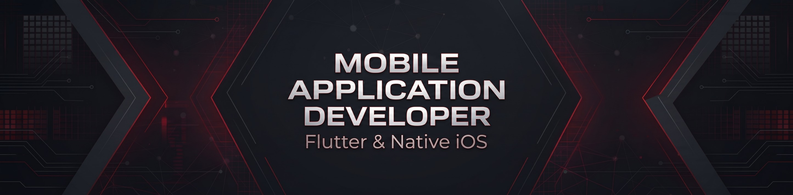

  <!-- HERO BANNER -->
  <!-- If you uploaded the image file, use this line: -->
  

  <!-- If you prefer the code-only SVG banner instead, use this line:
  
  -->

   

  <!-- NAVIGATION & CONTACT -->
  

    
    
    
  

  

    <b>Software Engineer &nbsp;•&nbsp; Cross-Platform Flutter & Native iOS &nbsp;•&nbsp; Systems Architecture</b>
  

---

### EXECUTIVE SUMMARY

Software Engineer specializing in production-grade **Flutter** and **Native iOS (Swift / SwiftUI)** applications alongside low-level systems engineering. Experienced in architecting end-to-end mobile solutions, reactive state management, RESTful API integrations, and TestFlight release pipelines, complemented by strong foundations in **C++, Compiler Construction, and Applied Machine Learning**.

- **Current Focus:** Engineering real-time cross-platform mobile ecosystems and native iOS architectures.
- **Academic Foundation:** B.S. Computer Science at FAST-NUCES, Lahore.
- **Portfolio:** [izenabbas.vercel.app](https://izenabbas.vercel.app)

---

### TECHNICAL ARCHITECTURE

  **Mobile Engineering**
  

    
    
    
    
    
    
  

  **Systems, Backend & Data**
  

    
    
    
    
    
    
  

  **DevOps & Tooling**
  

    
    
    
    
  

---

### SELECTED WORK

| Repository | Domain | Architecture & Stack |
| :--- | :--- | :--- |
| **[Asset Advisor](https://github.com/IzenAbbas/Asset_price_predictor)** | Full-Stack Mobile & ML | Price prediction platform for vehicles and real estate built with **Flutter, FastAPI, Scikit-Learn, and Gemini API**. |
| **[Sift](https://github.com/IzenAbbas/Sift)** | Compiler Engineering | Domain-specific language compiler for ML data pipelines utilizing **C++, Flex, Bison, and LLVM IR**. |
| **[ultimate-dart-toolkit](https://github.com/IzenAbbas/ultimate-dart-toolkit)** | Mobile Architecture | Reusable utilities, networking layers, and core extensions for **Dart & Flutter** applications. |
| **[CineFAST](https://github.com/IzenAbbas/CineFast)** | Application Engineering | Full-featured cinema ticketing and seat reservation system built with **Java** and object-oriented design patterns. |
